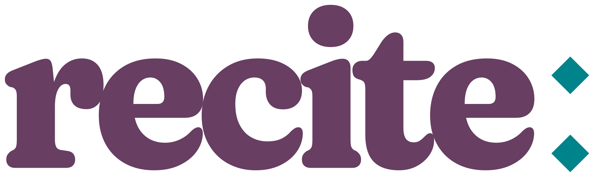
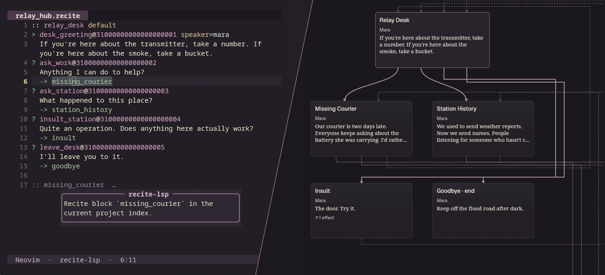

<picture>
  <source
    media="(prefers-color-scheme: dark)"
    srcset="assets/identity/recite-wordmark-reversed.svg"
  >
  
</picture>

> Words are events, they do things, change things.
>
> — Ursula K. Le Guin, "Telling Is Listening," *The Wave in the Mind* (2004)

Recite is testable, reviewable, and pleasant tooling for authoring interactive narratives. It's the
tool I've always wished I had when working on dialogue-heavy games.

[Open image](assets/readme/recite-scene.png)

I want the tooling to hold up as a story gets ambitious: scenes you can review and
[test](docs-site/src/content/docs/guides/testing-dialogue.md),
[localisation IDs](docs-site/src/content/docs/guides/localisation.md) that survive nearby edits, and
validation before you open the game.

Scripts make
[typed, schema-checked requests](docs-site/src/content/docs/reference/source-format.md#conditions-and-effects)
to your game rather than changing its state themselves.

Use [Writer](apps/writer/README.md), or the
[compiler](docs-site/src/content/docs/getting-started/install.md) and LSP with
[VS Code](editors/vscode/README.md), [Neovim](editors/recite-neovim/README.md) or
[Zed](editors/zed/README.md). Engine integrations: [Bevy](crates/recite-bevy/README.md) ·
[Godot](addons/recite/README.md) · [Unity](Packages/com.recite.dialogue/README.md).

It's still a preview (`0.1.0`), so you'll need to build from source for now.

[Docs](docs-site/src/content/docs/) · [Run the playground locally](docs-site/README.md). I haven't
put the site up yet.

I'd love to hear how you get on with it. [Code contributions aren't open yet](CONTRIBUTING.md).
